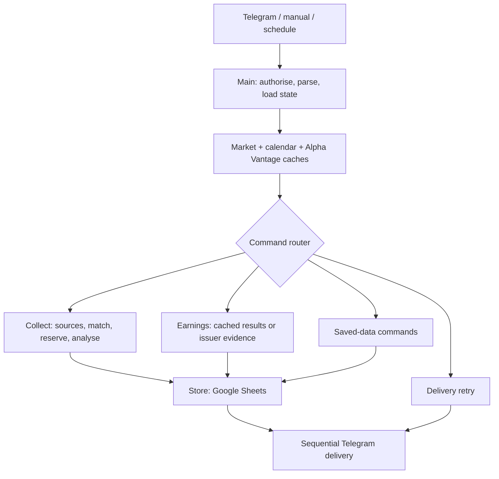

# TickerWatch

A Telegram research assistant built with n8n for a Bloomberg Trading Challenge team. It collects news, summarises relevant stories, tracks research cases and hypotheses, maintains a catalyst board, and provides a labelled demo allocation plus a market snapshot.

This is a private source repository. It contains the actual project workflows and setup workflow, with credential bindings and deployment-specific identifiers removed. It contains no CHECK workflows, execution logs, database copies or live portfolio records. It is not connected to Bloomberg or a brokerage and does not execute trades.

## What is included

- `workflows/`: ten runtime workflows and one database setup workflow, all exported inactive.
- `src/`: the exact JavaScript extracted from each exported Code node.
- `docs/`: architecture reports, setup notes and credential-type requirements.
- `tests/`: portable checks with synthetic data; no live API keys required.
- `compose.yml`: the n8n, task-runner and SearXNG runtime.
- `deployment/`: optional deployment reference files.

`workflows/*.json` are the canonical importable implementation. Editing an extracted `src/` file does not automatically update a workflow. After editing workflow JSON, run `npm run extract` to refresh the source view.

## Features

- Daily 07:00 Europe/Paris collection from BBC Business/World and company/macro Google News RSS.
- Deterministic universe matching, bounded model analysis, article excerpts and primary-source quote checks.
- Persistent cases, review/reopen state, research changes, thesis journals and team catalysts.
- Position-aware prioritisation and an explicitly fictional demo-portfolio option.
- Yahoo stock/benchmark reference outcomes and source-labelled corporate calendars.
- Yahoo SPY, Brent front-month futures and US 10-year Treasury-yield snapshot.
- Alpha Vantage earnings calendar, estimates and historical EPS. Sentiment is implemented but requires provider entitlement; the free key used during development returned premium-required.
- Compact replies, with `details` available on supported read commands.
- Saved briefing delivery state, controlled retry and a production error handler.

## Architecture



The main workflow controls branches, budgets and persistence. The LLM supplies bounded interpretation and extraction; it does not control arbitrary tools, portfolio weights, return calculations or trading decisions.

## Start a new installation

Requires Docker Compose, a public HTTPS endpoint for Telegram, and the service credentials listed below. Python 3 is useful for local maintenance; Node.js 22+ runs the repository checks.

1. Copy `.env.example` to `.env`. Replace every `CHANGE_ME` value with a distinct random secret and set your HTTPS `WEBHOOK_URL`. Keep `.env` local.
2. Run `docker compose up -d` and complete n8n account setup at `http://localhost:5678`.
3. Create credentials in n8n: Telegram bot, Google Sheets OAuth2, Groq, Tavily and Alpha Vantage Query Auth. For Alpha Vantage, the query parameter name must be exactly `apikey`. See `docs/credential-requirements.json` for the nodes and credential types. No credential is shipped in these exports.
4. Import the workflow files using the CLI, which preserves the repository's stable workflow IDs:

   ```sh
   docker compose cp workflows n8n:/tmp/tickerwatch-workflows
   docker compose exec n8n n8n import:workflow --separate --input=/tmp/tickerwatch-workflows
   ```

   Alternatively, run `python scripts/import_workflows.py` to stage and import only the eleven manifest-listed files. The root `manifest.json` is kept outside the import directory. The helper never publishes or executes workflows.

5. Assign credentials to the imported nodes. For UI imports into an existing instance, check/relink every Execute Sub-workflow reference and the main error-workflow setting because the UI may allocate new IDs.
6. Run **Setup Database** manually once. It creates seven tabs and the ten starter listings. Record the returned spreadsheet ID.
7. In Main **Settings** and Error Handler **Error Settings**, replace `SET_OWNER_CHAT_ID` and `PASTE_SPREADSHEET_ID` with your private Telegram chat and new spreadsheet. Review all other limits and reviewed-exposure settings.
8. Start your compatible Yahoo Finance MCP service and make its endpoint reachable from the n8n container. The default configuration expects `http://host.docker.internal:8931/mcp`. That external provider implementation is not bundled here. It needs `tools/list` and the `get_company_info` / `get_market_news` contracts used in the exported HTTP nodes. Direct Yahoo chart requests do not use this MCP server. SearXNG runs at the Compose service address configured in the workflows.
9. Publish the callable helpers and Error Handler first, then publish Main. A CLI publication requires a running n8n process to reload/restart before it takes effect. Do not publish Setup Database as an automated daily workflow.
10. Test `/help`, `/portfolio`, `/catalysts`, and `/earnings MSFT NASDAQ`. Telegram commands are restricted to the configured private owner chat.

The exports have stable project-local IDs, no live credential IDs, no pin data and no execution state. They do not connect to the original installation automatically. Do not import them into a production instance without reviewing the configuration and workflow-ID choices.

## Commands

| Command | Purpose |
| --- | --- |
| `/brief` | Latest saved briefing |
| `/portfolio` | Allocation and market snapshot |
| `/focus` | Research priorities |
| `/stock NVDA NASDAQ` | Saved company research |
| `/earnings MSFT NASDAQ` | Reported figures and expectations |
| `/expectations NVDA NASDAQ` | Provider EPS/revenue expectations |
| `/results NVDA NASDAQ` | Provider historical EPS |
| `/catalysts` | Upcoming events and team plans |
| `/changes` | Changes from the delivered-report baseline |
| `/outcomes` | Stock/benchmark reference observations |
| `/queue`, `/case TW-...` | Research cases |
| `/review TW-...`, `/reopen TW-...` | Case read/review state |
| `/theses` | Team thesis journals |
| `/universe` | Supported listing identifiers |
| `/alphastatus` | Provider coverage and budget |
| `/help details` | Full command reference |

Append `details` to a supported read command, for example `/portfolio details` or `/earnings MSFT NASDAQ details`. A ticker is currently required for `/earnings`. On-demand earnings/stock lookup is restricted to the configured universe.

To enter allocations: `/position NVDA NASDAQ 25 | Semiconductors`, then `/cash 10`. `/portfolio new` starts an empty actual allocation. The optional `data/demo-portfolio.json` contains an explicitly fictional Meta record for demonstrations; it is not real account data. See `docs/SETUP.md` for adding it manually.

## Checks

```sh
npm test
npm run check
```

No npm dependencies or live credentials are needed for these checks. They compile workflow JavaScript, verify references and credential removal, and exercise representative parsing, cache, market-math and earnings fallback paths. Historical live checks from the development machine are intentionally not uploaded and are not reproducible through this test suite.

## Current limits

- Tested research universe: ten listings. EPS native-listing mappings are verified for AAPL, MSFT and NVDA; other listings retain their existing Yahoo/issuer coverage. ADR EPS is not silently substituted.
- Alpha Vantage reservations: at most 24/day in the workflow's UTC ledger. Other uses of the same key are not counted. Actual plan entitlements/rate limits are provider-controlled.
- Current collection cap: three analyses/run, with at most two selected stories in the compact briefing. Model calls have intentional pacing waits.
- Source availability, calendar parsing and model interpretation can fail; shape/quote checks are not an independent truth guarantee.
- Portfolio weights are entered snapshots. Reference outcomes exclude trade execution, fees and portfolio P&L; listing currencies are not business economic exposure.
- Sheets is not a transactional multi-user database. Concurrency one and delivery state reduce duplicate work but do not provide distributed exactly-once delivery.

## Presentation material

The HTML architecture guide describes the 21 October baseline, with an Alpha Vantage/market addendum for 22 October. The current exports additionally include compact read views and the cached earnings fallback repair. See `docs/CURRENT_STATE.md` for those later changes. Open the HTML files locally in a browser; this private repository does not enable GitHub Pages.
